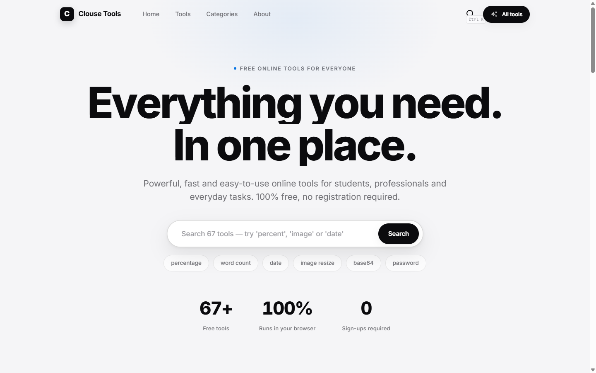
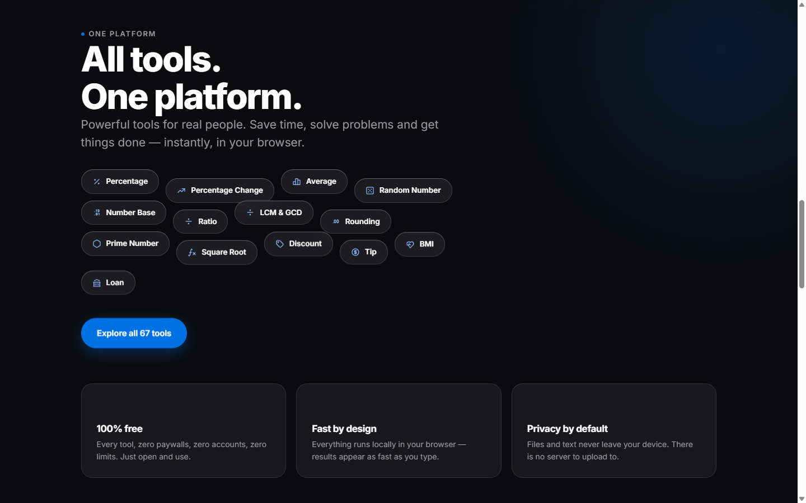
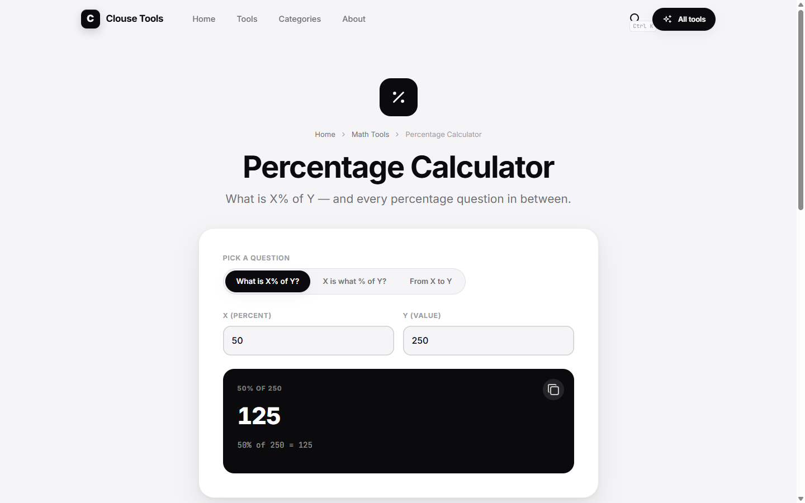
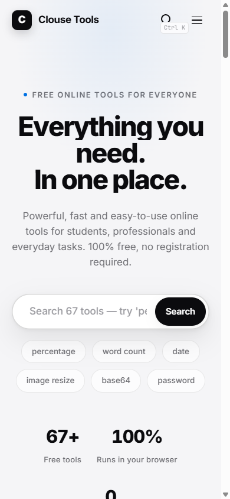

# CLOUSE TOOLS — 67 Free Online Tools

[](https://github.com/ViictorN/clouse-tools/actions/workflows/ci.yml)
[](https://vercel.com)
[](LICENSE)
[](#)

Multi-page, zero-backend web platform featuring **67 fully functional tools** that run 100% inside your browser — zero tracking, zero uploads, instant execution.

---

## ⚡ Quick Start

### Development
```bash
# Install dependencies
npm install

# Start Vite dev server with Hot Module Replacement (HMR)
npm run dev
```
Open [http://localhost:5173](http://localhost:5173) in your browser.

### Production Build & Preview
```bash
# Build optimized multi-page production bundle in dist/
npm run build

# Preview production build locally
npm run preview
```

### Standalone Node Server
```bash
npm start
# Runs portable static server on http://localhost:8765
```

---

## 🚀 Deploy to Vercel

The project is fully preconfigured for **[Vercel](https://vercel.com)**:
- `vercel.json` includes automated clean URLs (`/tools`, `/category`, `/tool`), immutable asset caching, and strict security headers (`X-Content-Type-Options`, `X-Frame-Options`, `Referrer-Policy`).
- Framework is auto-detected as **Vite**, with build output in `dist/`.

To deploy:
1. Push this repository to GitHub: `https://github.com/ViictorN/clouse-tools.git`
2. In Vercel, click **Add New Project** and import `ViictorN/clouse-tools`.
3. Deploy! Vercel runs `npm run build` and serves the site with global CDN performance.

---

## 🧭 Pages & Routing

| Page | URL Path | Description |
|---|---|---|
| `index.html` | `/` | Homepage — hero, live search, popular tools, dark feature band, category grid |
| `tools.html` | `/tools` | All 67 tools directory with interactive category filters |
| `category.html` | `/category?cat={id}` | Category pages (`math`, `text`, `date`, `converters`, `developer`, `design`) |
| `tool.html` | `/tool?tool={slug}` | Individual tool pages with instant client-side computation |
| `search.html` | `/search?q={query}` | Search results page with fallback and suggestions |
| `components.html`| `/components` | Design system component showcase |
| `about.html` | `/about` | Project mission, architecture and contact info |
| `privacy.html` | `/privacy` | Privacy policy highlighting zero data retention |
| `terms.html` | `/terms` | Terms of service |

---

## 🛠️ Tech Stack & Architecture

- **Bundler & Tooling**: [Vite](https://vite.dev) with native Multi-Page Application (MPA) bundling.
- **Frontend Core**: Vanilla HTML5 + modern CSS3 custom properties design system.
- **Motion & Smooth Scrolling**: GSAP 3.13 (ScrollTrigger, SplitText) + Lenis smooth scroll.
- **Typography**: Inter + JetBrains Mono.
- **Icons**: 88 inline optimized Tabler SVGs.
- **CI / CD**: GitHub Actions (`.github/workflows/ci.yml`) validating builds on push and pull requests.
- **Deployment**: Vercel ready with automated header optimization and clean routing.

```
clouse-tools/
├── .github/workflows/ci.yml  — Automated CI build validation
├── css/style.css             — Design system tokens, glass nav, dark band, responsive layout
├── js/
│   ├── icons.js              — Tabler SVG icon map
│   ├── data.js               — 6 categories, 67 tools catalog, and search algorithm
│   ├── tool-engine.js        — 67 tool logic engines (100% in-browser)
│   ├── tool-entry.js         — Dedicated module entry for tool execution
│   └── main.js               — UI orchestrator, Ctrl+K command palette, motion & spotlight
├── screenshots/              — Visual documentation
├── index.html                — Multi-page entrypoints
├── package.json              — ESM scripts, Vite dependencies & metadata
├── vercel.json               — Vercel headers, clean URLs & build configuration
├── vite.config.js            — MPA Rollup build configuration
└── _server.cjs               — Portable lightweight dev server
```

---

## ⌨️ Shortcuts & Accessibility

- **`Ctrl + K`** (or **`/`**) — Open global command palette search from anywhere.
- **`Esc`** — Close search overlay.
- **Keyboard Navigation** — Arrow up/down + Enter inside the command palette.
- **Accessibility** — `prefers-reduced-motion` compliance, skip links, semantic landmarks, WCAG AA contrast.

---

## 📸 Screenshots

| Desktop Hero | Dark Band | Tool Page | Mobile |
|---|---|---|---|
|  |  |  |  |

---

## 📄 License

MIT © [Victor Gomes](https://github.com/ViictorN)
